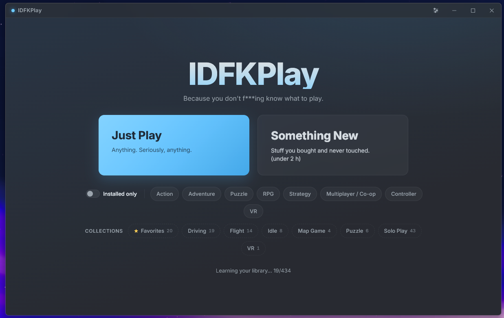
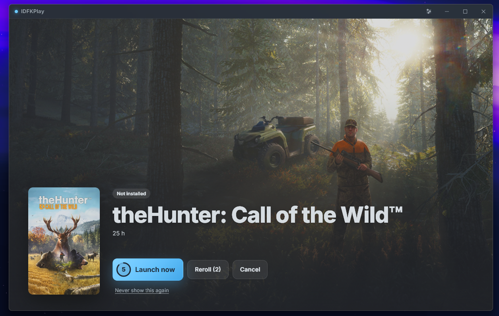

# IDFKPlay

**I Don't F\*\*\*ing Know what to play.** One click picks a random game from your Steam library and launches it.



## Download

Grab **`IDFKPlay_x.y.z_x64-setup.exe`** from the [latest release](../../releases/latest) and run it.

- Windows 10/11, 64-bit. No admin rights needed.
- Adds a Start Menu entry and a desktop shortcut. Uninstall from *Settings → Apps*.
- The installer isn't code-signed yet, so Windows may say *"Windows protected your PC"*.
  Click **More info → Run anyway**.

## What it does

- **Just Play** picks anything you own. **Something New** picks only games you've played less than 2 hours
  (adjustable).
- A slot-machine spin through your cover art lands on the pick, the game's art fills the window, and it
  **launches in 5 seconds** unless you stop it. Enter launches now, **R** rerolls, Esc cancels.
- **Rerolls are limited**: 2 per session by default (0–10 or unlimited in Settings), and it gets snarky.
  Canceling doesn't dodge them: once they're used up, picking again brings the same game back.
- **Filters** you can combine:
  - **Installed only**: remembered between launches.
  - **Moods**: Action, Adventure, Puzzle, RPG, Strategy, plus Multiplayer/Co-op, Controller and VR.
    A game must match *any* genre you pick and *every* feature you pick.
  - **Your Steam collections**, Favorites included: pick from any you select.
- **Never show this again** for games you're done with; manage the list in Settings.
- **Games from other launchers**: add any game in *Settings → Games* with a program (plus arguments) or a
  launcher link, a cover image, moods, and hours played. Battle.net games launch through Battle.net so you're
  signed in automatically (`Battle.net.exe` with `--exec="launch WoW"`, using the game's code).
- **Edit any game**: fix a missing cover, rename it, set your own moods, or favorite it. ★ on the reveal
  screen adds or removes a favorite; the Favorites chip combines Steam's favorites with yours.
- Games you've hidden in Steam, DLC, soundtracks, tools and redistributables are skipped automatically.
- Finds Steam and every library on every drive by itself. Works offline once it has learned your library.



## Include games you haven't installed (optional)

Out of the box IDFKPlay only sees **installed** games. A free Steam Web API key lets it see everything you
own; uninstalled picks open Steam's install dialog.

1. Go to <https://steamcommunity.com/dev/apikey> and sign in with Steam.
2. For **Domain name**, type `localhost`. Agree and register.
3. Paste the key into **Settings → Steam Web API key**.

If it says Steam returned no games, set your profile's **Game details** to **Public**
(Steam → Profile → Edit Profile → Privacy Settings).

The key is stored in Windows Credential Manager on your PC and is only ever sent to Steam.

## Privacy

Everything stays on your PC. IDFKPlay reads your local Steam files and talks only to Steam
(`api.steampowered.com` and Steam's image CDN). There's no account, telemetry or analytics.

Settings and caches live in `%APPDATA%\IDFKPlay\`:

| File | What |
|---|---|
| `settings.json` | Settings, filters you saved, blacklist |
| `owned-games.json` | Last list of owned games from Steam (used when offline) |
| `metadata-cache.json` | Type, categories and tags per game |
| `tag-names.json` | Steam's tag names (refreshed monthly) |
| `games.json` | Games you added and your edits to Steam games |
| `art\` | Copies of images you picked for games |

Delete the folder to reset everything.

## Build from source

Prerequisites:

| Tool | Install |
|---|---|
| Node.js LTS (20+) | `winget install OpenJS.NodeJS.LTS` |
| Rust stable (MSVC) | `winget install Rustlang.Rustup`, then `rustup default stable-msvc` |
| Visual Studio Build Tools | "Desktop development with C++" workload |
| WebView2 | Preinstalled on Windows 10/11 |

```bash
npm install
npm run tauri dev
```

Build the installer locally (output in `src-tauri/target/release/bundle/nsis/`):

```bash
npm run tauri build
```

Tests and tools:

```bash
npm run check                               # type-check the frontend
cd src-tauri && cargo test                  # Rust tests
cd src-tauri && cargo run --example scan    # what the app finds in your Steam install
cd src-tauri && cargo run --example pick    # how many games each filter matches
```

### Releasing

Bump `version` in `package.json` and `src-tauri/tauri.conf.json`, commit, then push a tag:

```bash
git tag v0.2.0
git push origin v0.2.0
```

GitHub Actions builds the installer and attaches it to a **draft** release. Review it on the Releases page and
publish.

## How it works

| Piece | Where |
|---|---|
| Steam install, libraries, accounts, local playtime | `src-tauri/src/steam/` (registry, `libraryfolders.vdf`, `appmanifest_*.acf`, `loginusers.vdf`, `localconfig.vdf`) |
| Owned games incl. uninstalled | Steam Web API `IPlayerService/GetOwnedGames` |
| Type, categories, tags | Steam's batch store service `IStoreBrowseService/GetItems` (100 games per request) + `IStoreService/GetTagList`, fetched in the background and cached |
| New games | Rescanned at launch and when the window regains focus (at most once a minute); new games are learned first |
| Collections, Favorites, Hidden | `userdata\<id>\config\cloudstorage\cloud-storage-namespace-1.json` |
| Cover / hero art | Steam's local `appcache\librarycache`, then Steam's CDN |
| Picking, filters, rerolls | `src-tauri/src/picker.rs` |
| UI | Svelte 5 in `src/`; all on-screen copy in `branding.json` |

Built with [Tauri 2](https://tauri.app) (Rust) and [Svelte 5](https://svelte.dev) + TypeScript.

Not affiliated with or endorsed by Valve. Steam and the Steam logo are trademarks of Valve Corporation.

## License

[MIT](LICENSE)
